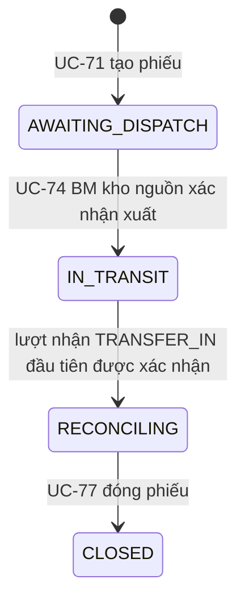
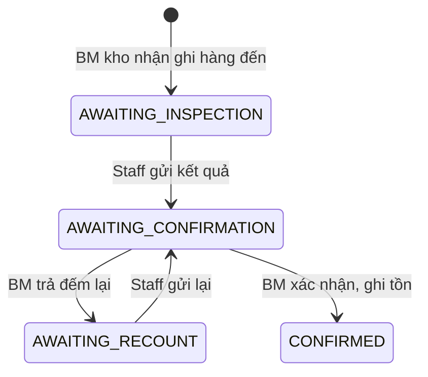

# Giải thích code phiếu chuyển kho (UC-71 đến UC-77) và nhận hàng chuyển kho

Tài liệu này giải thích luồng chuyển hàng giữa hai kho: tạo phiếu, chuẩn bị, xuất, nhận ở kho đích, xử lý thiếu thừa, rồi đóng phiếu. Căn cứ là R3 bản 05/11 (UC-71 đến UC-77, UC-43 đến UC-45 và UC-106 cho hàng chuyển kho, BR-56 đến BR-68, BR-75, BR-76).

Phần chuẩn bị hàng (`PUT /{id}/prepared-lines`, UC-57) là code của Mạnh. Tài liệu chỉ nhắc tới vì luồng cần nó.

| API | Dùng cho | Ai gọi |
|---|---|---|
| `POST /api/v1/transfer-orders` | UC-71: tạo phiếu | Owner, BM kho tổng |
| `PUT /api/v1/replenishment-requests/{id}/to-purchase` | UC-71: chuyển phần thiếu sang mua | Owner, BM kho tổng |
| `GET /api/v1/transfer-orders` | UC-72: danh sách | Xem mục 4 |
| `GET /api/v1/transfer-orders/{id}` | UC-73: chi tiết | Xem mục 4 |
| `GET /api/v1/transfer-orders/{id}/dispatch-preview` | UC-74: xem lô sẽ lấy | Owner, BM kho tổng, BM kho nguồn |
| `POST /api/v1/transfer-orders/{id}/dispatch` | UC-74: xác nhận xuất | BM kho nguồn, không phải người chuẩn bị |
| `POST /api/v1/transfer-orders/{id}/receipts` | UC-106: ghi hàng đến kho đích | BM kho đích |
| `GET /api/v1/transfer-orders/{id}/receipts/{receiptId}` | Xem một lượt nhận | BM kho nhận, Owner, BM kho tổng, Staff được giao |
| `PUT /api/v1/transfer-orders/{id}/receipts/{receiptId}/result` | UC-43: Staff ghi kết quả kiểm | Staff được giao kiểm |
| `POST /api/v1/transfer-orders/{id}/receipts/{receiptId}/recount` | UC-44: trả đếm lại | BM kho nhận |
| `POST /api/v1/transfer-orders/{id}/receipts/{receiptId}/confirm` | UC-44, UC-45: xác nhận và ghi tồn | BM kho nhận |
| `POST /api/v1/transfer-orders/{id}/extra-dispatch` | UC-75: xác nhận phần xuất thêm | BM kho nguồn |
| `POST /api/v1/transfer-orders/{id}/discrepancy/decisions` | UC-76: quyết định xử lý phần thiếu | Owner, BM kho tổng |
| `POST /api/v1/transfer-orders/{id}/returns` | UC-76: ghi hàng trả về kho nguồn | BM kho nguồn |
| `GET /api/v1/transfer-orders/{id}/closing-preview` | UC-77: xem trước khi đóng | Owner, BM kho tổng |
| `POST /api/v1/transfer-orders/{id}/close` | UC-77: đóng phiếu | Owner, BM kho tổng |

"Kho nhận" là kho đích với lượt nhận `TRANSFER_IN`, và là kho nguồn với lượt trả về `RETURN_TO_SOURCE`.

## 1. File chính

Đường dẫn tính từ `src/main/java/fu/hl/g64/motorflow/`.

| File | Làm gì |
|---|---|
| `transfer/controller/TransferOrderController.java` | Tạo, danh sách, chi tiết, xuất, xuất thêm, đóng |
| `transfer/controller/TransferReceiptController.java` | Các lượt nhận của phiếu |
| `transfer/controller/TransferDiscrepancyController.java` | Quyết định UC-76 và ghi hàng trả về |
| `transfer/service/impl/TransferOrderServiceImpl.java` | Quy tắc tạo, xuất, xuất thêm, đóng |
| `transfer/service/impl/TransferReceiptServiceImpl.java` | Quy tắc nhận hàng và trả về, mở và đóng hồ sơ sai lệch |
| `transfer/service/impl/TransferDiscrepancyServiceImpl.java` | Quy tắc quyết định UC-76 |
| `transfer/helper/TransferReconciliation.java` | Mọi con số đối soát, xem mục 6 |
| `transfer/helper/RequestedParts.java` | Kiểm tra phụ tùng trùng, không tồn tại, ngừng kinh doanh (dùng chung với UC-68) |
| `inventory/dto/SplitMovePosting.java`, `InventoryPostingService.moveToStatuses` | Chuyển một lô sang nhiều trạng thái trong một lần ghi |

**Thêm vào code của Mạnh, chỉ thêm, không sửa:**

- `GoodsReceiptNote.transfer`;
- `GoodsReceiptNoteLine.transfer` và `settleTransferExcess`;
- `DiscrepancyCase.transfer`;
- `DiscrepancyResolutionEvent.transferLoss`.

Không sửa migration hay schema.

## 2. Trạng thái phiếu chuyển kho

- Lượt nhận sau, xuất thêm, quyết định, và hàng trả về đều diễn ra khi phiếu ở `RECONCILING`.
- Không có API huỷ phiếu. Xem câu hỏi 11.5.
- Gọi lại `dispatch` hoặc `close` lần nữa thì trả phiếu như cũ, không ghi tồn lần nữa.

## 3. Trạng thái một lượt nhận (goods_receipt_note)

| Loại | Ai ghi hàng đến | Mỗi dòng chờ bao nhiêu (`documentQty`) |
|---|---|---|
| `TRANSFER_IN` | BM kho đích | Phần còn phủ được của từng phụ tùng, xem mục 7 |
| `RETURN_TO_SOURCE` | BM kho nguồn | Số BM khai, không vượt phần còn phủ được |

Mỗi phiếu chỉ có một lượt `TRANSFER_IN` chưa xác nhận tại một thời điểm (`MSG211`).

## 4. Quyền của từng vai trò

| Việc | Owner | BM kho tổng | BM kho nguồn | BM kho đích | Staff |
|---|---|---|---|---|---|
| Tạo phiếu, chuyển sang mua | Được | Được | 403 | 403 | 403 |
| Danh sách, chi tiết | Mọi phiếu | Mọi phiếu | Phiếu đi từ kho mình | Phiếu tới kho mình | Phiếu mình chuẩn bị hoặc kiểm |
| Xem trước khi xuất | Được | Được | Được | 403 | 403 |
| Xác nhận xuất | 403 | Chỉ khi là kho nguồn | Được, không phải người chuẩn bị | 403 | 403 |
| Ghi hàng đến, trả đếm lại, xác nhận lượt nhận | 403 | Chỉ khi là kho nhận | Lượt trả về | Lượt `TRANSFER_IN` | 403 |
| Ghi kết quả kiểm | 403 | 403 | 403 | 403 | Người được giao |
| Xác nhận xuất thêm | 403 | Chỉ khi là kho nguồn | Được | 403 | 403 |
| Quyết định UC-76, xem trước khi đóng, đóng | Được | Được | 403 | 403 | 403 |

Ghi chú:

- "Mọi phiếu" dùng `StoreScope.seesEveryStore`.
- Staff thấy chi tiết nhưng không thấy các cột đối soát (`receivedQty`, `unresolvedQty`, ...). Staff cũng không thấy giá vốn lô, vì `unitCost` chỉ trả cho Owner.
- Người xác nhận lượt nhận không được là người ghi kết quả kiểm (`MSG32`).
- Owner không có cửa hàng nên không làm được việc của kho nguồn hay kho đích.

## 5. Ghi tồn từng bước

| Bước | Ghi tồn | `movement_type` | Nguồn |
|---|---|---|---|
| UC-71 tạo phiếu | Không. Không giữ hàng | | |
| UC-57 chuẩn bị | Không | | |
| UC-74 xuất | Kho nguồn `AVAILABLE` sang kho đích `IN_TRANSIT`, theo lô FEFO rồi FIFO, bỏ lô hết hạn | `TRANSFER_DISPATCH` | phiếu chuyển |
| Xác nhận lượt `TRANSFER_IN` | Kho đích `IN_TRANSIT` sang kho đích `AVAILABLE` (đạt) và `DAMAGED` (hỏng), đúng lô của phiếu | `TRANSFER_RECEIPT` | lượt nhận |
| Phần nhận thừa | Không ghi khi nhận. Ghi khi đóng phiếu | | |
| UC-75 xác nhận xuất thêm | Không. Chỉ cộng `extraDispatchedQty` | | |
| Xác nhận lượt `RETURN_TO_SOURCE` | Kho đích `IN_TRANSIT` sang kho nguồn `AVAILABLE` và `DAMAGED`, đúng lô của phiếu (BR-61) | `TRANSFER_RECEIPT` | lượt nhận |
| UC-77 đóng phiếu | Kho nguồn `AVAILABLE` sang kho đích `AVAILABLE`, đúng bằng `extraDispatchedQty`, FEFO rồi FIFO | `TRANSFER_EXTRA_DISPATCH` | phiếu chuyển |

**Đúng lô của phiếu:**

- `findTransitLots` cộng các dòng `IN_TRANSIT` của phiếu, các lượt nhận và các điều chỉnh của nó tại kho đích, để biết lô nào còn trên đường. Kết quả xếp theo FEFO.
- Nhờ vậy, hai phiếu cùng phụ tùng nhận đúng lô của mình. Đã có test riêng cho trường hợp này.

**Cùng một lô vừa đạt vừa hỏng:**

- Hai lần `move()` sẽ tạo hai dòng trừ trùng khoá unique của `stock_movement`.
- Vì vậy dùng `moveToStatuses`: một dòng trừ cho mỗi lô, rồi các dòng cộng theo từng trạng thái.

Mọi thao tác ghi khoá theo thứ tự: phiếu chuyển (`findByIdForUpdate`), rồi lượt nhận, rồi hồ sơ sai lệch, rồi tồn. Các dòng được xử lý theo `productId` tăng dần.

## 6. Công thức đối soát

Mọi màn hình, kiểm tra và bước đóng phiếu đều đọc số từ `TransferReconciliation.byProduct`, nên các số không bao giờ lệch nhau. Tính cho từng phụ tùng của phiếu:

| Số | Công thức |
|---|---|
| `dispatched` | `dispatched_qty` của dòng (không gồm phần xuất thêm) |
| `received` | min(đạt + hỏng của các lượt `TRANSFER_IN` đã xác nhận, `dispatched`) |
| `extraReceived` | đạt + hỏng của các lượt đó trừ `received` (BR-68) |
| `returned` | đạt + hỏng của các lượt `RETURN_TO_SOURCE` đã xác nhận |
| `loss` | tổng event `APPROVED_LOSS` có điều chỉnh đã `APPLIED` (BR-66) |
| `unresolved` | max(`dispatched` − `received` − `returned` − `loss`, 0) (BR-60) |

Thêm hai số dẫn xuất:

- **Phần còn phủ được** (`uncovered`) = `unresolved` − số đang chờ trên các lượt nhận chưa xác nhận − số LOSS đã gắn nhưng điều chỉnh còn `DRAFT`, `PENDING` hoặc `APPROVED`. Không âm.
- **Số đã giao cho yêu cầu bổ sung** (`fulfilled`) = tổng `received` của mọi phiếu gắn với yêu cầu. Hàng thừa không tính vào đây.

**Ví dụ.** Xuất 4, nhận đạt 1, chờ trả về 2 trên lượt chưa xác nhận:

- `unresolved` = 3;
- phần còn phủ được = 1, nên lượt nhận muộn tiếp theo chỉ chờ 1.

## 7. UC-76: xử lý phần thiếu

Khi lượt nhận được xác nhận mà phụ tùng còn `unresolved > 0` và chưa có hồ sơ, service mở `discrepancy_case` loại `TRANSFER` với `short_qty = unresolved`. Owner và BM kho tổng được báo `TRANSFER_DISCREPANCY`.

**Quyết định chỉ là lịch sử.** `POST /discrepancy/decisions` ghi `audit_log` `TRANSFER_DISCREPANCY_DECIDED` và gửi thông báo. Quyết định không làm giảm số nào, cũng không giữ chỗ.

**Chỗ chặn là số thật trên chứng từ:**

| Cách xử lý | Chứng từ | Chặn ở đâu | Khi nào giảm `unresolved` |
|---|---|---|---|
| Đến muộn | Lượt `TRANSFER_IN` mới | `documentQty` = phần còn phủ được | Khi lượt đó được xác nhận. Ghi event `LATE_DELIVERY_RECEIVED` gắn lượt nhận |
| Trả về nguồn | Lượt `RETURN_TO_SOURCE` | Số khai ≤ phần còn phủ được (`MSG217`). Staff ghi không quá số khai (`MSG220`) | Khi lượt đó được xác nhận. Ghi event `RECEIVED_BACK_AT_SOURCE` gắn lượt nhận |
| Mất hoặc hỏng | Yêu cầu điều chỉnh `STOCK_LOSS` của phiếu | Số trên quyết định ≤ phần còn phủ được. Điều chỉnh phải ghi giảm `IN_TRANSIT` ở kho đích đúng bằng số đó và chưa gắn hồ sơ nào (`MSG219`) | Khi điều chỉnh `APPLIED`. Event `APPROVED_LOSS` được ghi ngay lúc quyết định |
| Giao bù (BR-62) | Phiếu mới có `makeupForCaseId` | `MSG206` | Không bao giờ. Phiếu gốc vẫn thiếu |

- Hồ sơ đóng `ALL_SETTLED` khi `unresolved` về 0, ngay lúc xác nhận lượt nhận cuối.
- Điều chỉnh bị `REJECTED`, `CANCELLED` hoặc `WITHDRAWN` thì phần đó trở lại thành phần còn phủ được.

## 8. UC-75 và UC-77

**UC-75 xác nhận xuất thêm:**

- BM kho nguồn xác nhận từng phụ tùng, từ 0 tới phần nhận thừa chưa xác nhận (`MSG214`).
- Các lần xác nhận cộng dồn. Dòng nào khai 0 thì phải có lý do (`MSG215`).
- Có thể đính kèm bằng chứng (`evidence`).

**UC-77 đóng phiếu.** Kiểm tra theo thứ tự. Gặp lỗi đầu tiên thì trả 409 kèm danh sách phụ tùng:

1. `MSG221`: còn phụ tùng có `unresolved > 0` (BR-63);
2. `MSG222`: `extraReceived > extraDispatchedQty`;
3. `MSG223`: kho nguồn không đủ hàng bán được cho `extraDispatchedQty`.

`closing-preview` trả cả 3 mã cùng lúc trong `blockedBy`.

Khi đóng được:

- ghi tồn phần xuất thêm (mục 5);
- đặt `closedBy`, `closedAt` và trạng thái `CLOSED`;
- ghi audit `TRANSFER_ORDER_CLOSED`;
- báo BM kho nguồn và BM kho đích `TRANSFER_CLOSED`.

**Yêu cầu bổ sung tự đóng.** Yêu cầu chuyển `CLOSED` khi đủ cả hai điều kiện:

- mọi phiếu gắn với yêu cầu đã `CLOSED`;
- mỗi dòng có `fulfilled + toPurchaseQty ≥ requestedQty`.

Khi đó service ghi audit `REPLENISHMENT_REQUEST_CLOSED` và báo người tạo yêu cầu `REPLENISHMENT_CLOSED`. Việc kiểm tra chỉ chạy khi một phiếu của yêu cầu được đóng.

## 9. Phần đang chờ UC-83 đến UC-85

Repo chưa có service tạo, duyệt và áp dụng yêu cầu điều chỉnh, nên:

- quyết định LOSS gắn được với điều chỉnh, nhưng `lossQty` chỉ tăng khi có ai đó đặt điều chỉnh thành `APPLIED`;
- phiếu có hàng mất thật chưa đóng được qua API cho tới khi xong UC-83 đến UC-85;
- trong test, điều chỉnh và dòng ghi giảm `IN_TRANSIT` được tạo bằng SQL;
- khi làm UC-85, phần áp dụng phải ghi giảm `IN_TRANSIT` ở kho đích theo đúng lô của phiếu. Phần đối soát không phải sửa.

## 10. Mã MSG mới

| Mã | HTTP | Khi nào |
|---|---|---|
| MSG200 | 400 | Kho nguồn trùng kho đích |
| MSG201 | 400 | Số chuyển vượt số bán được ở kho nguồn |
| MSG202 | 400 | Số chuyển vượt nhu cầu còn lại của yêu cầu bổ sung |
| MSG203 | 400 | Kho đích không phải cửa hàng tạo yêu cầu |
| MSG204 | 400 | Phụ tùng không có trong yêu cầu |
| MSG205 | 400 | Số cần mua vượt số chưa lên phiếu |
| MSG206 | 400 | Dòng giao bù không hợp lệ |
| MSG207 | 409 | Chưa có kết quả chuẩn bị |
| MSG208 | 400 | Số xuất khác số đã chuẩn bị |
| MSG209 | 400 | Không phụ tùng nào được chuẩn bị |
| MSG210 | 409 | Không còn hàng chờ nhận |
| MSG211 | 409 | Đang có lượt nhận chưa xác nhận |
| MSG212 | 400 | Số hỏng vượt số chờ nhận |
| MSG213 | 409 | Không còn hàng thừa chờ xác nhận |
| MSG214 | 400 | Số xuất thêm ngoài khoảng cho phép |
| MSG215 | 400 | Khai 0 mà không có lý do |
| MSG216 | 400 | Phụ tùng không có hồ sơ sai lệch đang mở |
| MSG217 | 400 | Vượt phần còn phủ được |
| MSG218 | 400 | Quyết định LOSS thiếu yêu cầu điều chỉnh |
| MSG219 | 400 | Yêu cầu điều chỉnh không hợp lệ cho quyết định LOSS |
| MSG220 | 400 | Số nhận lại vượt số đang trả về |
| MSG221 | 409 | Đóng phiếu khi còn phụ tùng chưa có kết quả |
| MSG222 | 409 | Đóng phiếu khi phần nhận thừa chưa được xác nhận |
| MSG223 | 409 | Đóng phiếu khi kho nguồn không đủ hàng cho phần xuất thêm |

Mã dùng lại:

| Mã | Ý nghĩa |
|---|---|
| MSG05 | Không có quyền |
| MSG29 | Sai trạng thái |
| MSG32, MSG124 | Người xác nhận trùng người ghi kết quả |
| MSG46 | Cửa hàng không hoạt động |
| MSG57 | Phụ tùng không tồn tại |
| MSG84 | Không đủ hàng |
| MSG93 | Phụ tùng trùng |
| MSG94 | Phụ tùng ngừng kinh doanh |
| MSG95 | Không tìm thấy yêu cầu |
| MSG132 | Không tìm thấy lượt nhận |
| MSG166, MSG167 | Thừa hoặc thiếu dòng |
| MSG175 | Không tìm thấy phiếu |

## 11. Câu hỏi cho BA

1. **Hàng hỏng có tính là đã nhận không?** Code tính hỏng vào `received` và ghi vào `DAMAGED` ở kho đích. Như vậy một cái hỏng không làm tăng `unresolved`, và cũng tính vào số đã giao cho yêu cầu bổ sung. Có đúng ý R3 không?
2. **Nhận thừa mà kho nguồn khai không xuất thêm.** Khi kho nguồn xác nhận 0 kèm lý do, `extraReceived > extraDispatchedQty` vẫn còn, nên `MSG222` chặn đóng phiếu. Hiện chưa có đường gỡ. Dự kiến sẽ cần một yêu cầu điều chỉnh đã duyệt cho phần thừa không có nguồn gốc. Cần BA chốt cách xử lý.
3. **Số xuất phải bằng số đã chuẩn bị.** Code bắt buộc (`MSG208`). Nếu lúc xuất phát hiện thiếu, phải trả về bước chuẩn bị. R3 có cho xuất ít hơn không?
4. **Hàng đang chuyển nằm ở kho đích.** `IN_TRANSIT` được ghi vào `stock_balance` của kho đích, không phải kho nguồn. Báo cáo tồn của kho nguồn sẽ không thấy hàng trên đường. Có đúng ý R3 không?
5. **Phiếu bị kẹt khi mọi số chuẩn bị đều bằng 0.** `MSG209` chặn xuất, mà không có API huỷ phiếu, nên phiếu nằm mãi ở `AWAITING_DISPATCH`. Có cần UC huỷ phiếu không?
6. **BR-86 (kỳ tồn kho đã khoá) chưa được kiểm tra.** Xuất, nhận và đóng phiếu đều ghi tồn qua `InventoryPostingService`. Service này tự mở kỳ, không có kiểm tra riêng. Lượt nhận hàng của nhà cung cấp cũng chưa kiểm tra. Cần BA chốt thời điểm áp dụng.
7. **Staff không sửa được kết quả đã gửi.** Muốn sửa, BM phải trả đếm lại (UC-44). Có cần cho Staff tự rút lại kết quả trước khi BM xem không?
8. **`short_qty` của hồ sơ giữ số thiếu lần đầu.** Lượt nhận muộn làm giảm `unresolved`, nhưng `short_qty` không đổi, vì giới hạn giao bù (`MSG206`) đọc số này. Màn hình nên hiện `unresolvedQty` của dòng phiếu thay cho `short_qty`. BA xác nhận giúp.
9. **BM kho tổng là kho nguồn.** Khi đó cùng một người vừa quyết định trả về vừa nhận hàng trả về. Code không chặn. Có cần tách người không?

## 12. Test và Postman

**Test** (`src/test/java/fu/hl/g64/motorflow/transfer/`):

| File | Kiểm tra |
|---|---|
| `TransferOrderApiTest` | UC-71 |
| `TransferOrderViewApiTest` | UC-72, UC-73 |
| `TransferDispatchApiTest` | UC-74 |
| `TransferReceiptApiTest` | Nhận hàng, gồm cùng lô vừa đạt vừa hỏng, và 2 phiếu cùng phụ tùng |
| `TransferExtraDispatchApiTest` | UC-75 |
| `TransferDiscrepancyApiTest` | UC-76: đến muộn, trả về đúng lô, vượt số, LOSS chờ và đã áp dụng, giao bù không giảm, quyền |
| `TransferClosingApiTest` | UC-77: không thừa thì không ghi tồn, thừa ghi đúng một lần, 3 lỗi chặn, yêu cầu tự đóng, quyền |

Tất cả chạy trên PostgreSQL thật qua `ApiTestUsers`.

**Postman.** Thư mục "Phiếu chuyển kho (UC-71 đến UC-77)" trong `postman/MotoFlow-Iteration2.postman_collection.json` chạy một luồng đủ:

1. kho tổng tạo phiếu 2 phụ tùng tới Cầu Giấy;
2. giao chuẩn bị, Staff ghi số, BM xuất;
3. kho đích ghi hàng đến và giao kiểm;
4. Staff ghi thiếu 1 ở phụ tùng đầu và thừa 1 ở phụ tùng sau, BM kho đích xác nhận;
5. đóng thử, bị `MSG221`;
6. kho nguồn xác nhận xuất thêm;
7. quyết định trả về, kho nguồn nhận lại hàng trả về;
8. đóng phiếu, xem biến động `TRANSFER_EXTRA_DISPATCH`.

Thư mục có thêm 3 ca lỗi: BM thường tạo phiếu (`MSG05`), người chuẩn bị tự xác nhận xuất (403), và đóng khi còn thiếu (`MSG221`).

Cần dữ liệu demo từ `scripts/seed/seed_demo_data.sql`. Mỗi lần chạy lấy đi 2 cái hàng bán được ở kho tổng.
